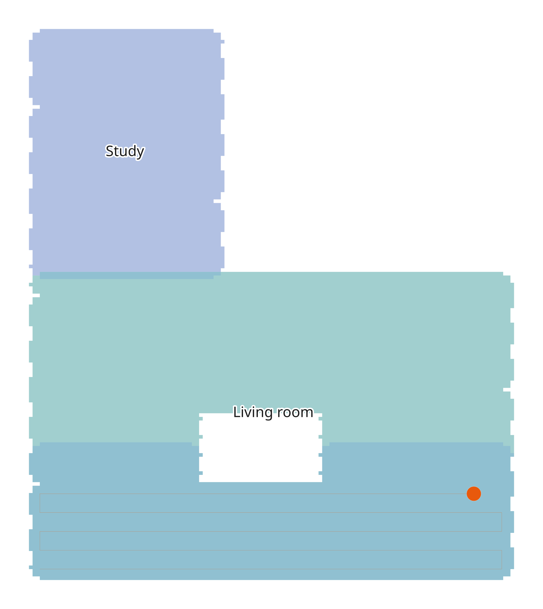

# Tuya Vacuum Local Map

[](https://github.com/marcoschicote/ha-tuya-vacuum-local-map/actions/workflows/ci.yml)
[](https://hacs.xyz/docs/faq/custom_repositories/)
[](https://codecov.io/gh/marcoschicote/ha-tuya-vacuum-local-map)

A Home Assistant integration that draws where a Tuya robot vacuum has cleaned, using only its local connection. No cloud, no Tuya account (once you have the vacuum's local key).



*A simulated map, not a real home.*

> **Status: early release, 0.1.1.** It has run on one vacuum (a Rowenta X-plorer) inside Home Assistant for a day, with its map and room labels checked. Known issues are listed in the [repository's issues](https://github.com/marcoschicote/ha-tuya-vacuum-local-map/issues). Expect rough edges, and see [Limits](#limits).

## What it does

- Listens to the vacuum on your network and reads the cleaning path and room list it already sends.
- Builds a coverage map that adds up across runs: darker where a spot was cleaned more often, with the latest path and the vacuum's position while it runs.
- Learns room outlines from runs you start for a single room in the app, and labels them.
- **Read-only.** It only asks for the status and sends keep-alive messages. It never sends a command, so it can't start the vacuum or wipe its map.

## Entities

| Entity | What it shows |
|---|---|
| Coverage map (image) | The map, as an SVG |
| Rooms (sensor) | How many rooms the vacuum has, with their IDs and names in an attribute |
| Current room (sensor) | The room under the vacuum during a run, once its outline is learned |
| Run points (sensor) | Points in the current or last run |
| Covered area (diagnostic sensor) | Area covered, in m² |
| Connected (binary sensor) | Whether the connection to the vacuum is up |
| Reset map (button, off by default) | Clears the map this integration keeps. Sends nothing to the vacuum |

## Install

You need Home Assistant 2026.2 or newer (the version it is tested on).

**With HACS:** add this repository as a custom repository (category: Integration), install **Tuya Vacuum Local Map**, and restart Home Assistant.

**By hand:** copy `custom_components/tuya_vacuum_local_map` into your Home Assistant `custom_components` folder and restart.

Then go to **Settings → Devices & services → Add integration → Tuya Vacuum Local Map**.

## Set up

You need three things about the vacuum:

- **Its address** on your network. Give it a fixed address in your router.
- **Its device ID.**
- **Its local key**: a 16-character secret that Tuya's cloud holds. If you already use [LocalTuya](https://github.com/xZetsubou/hass-localtuya) or [Tuya Local](https://github.com/make-all/tuya-local) for this vacuum, you have it already. Otherwise the [tinytuya setup wizard](https://github.com/jasonacox/tinytuya#setup-wizard---getting-local-keys) fetches it, using a Tuya developer account (its IoT Core subscription is a free trial that needs renewing, so it's best to fetch the key once and keep it).

The form also asks for the **protocol version**. 3.3 is right for most vacuums. If it says the key or protocol version looks wrong although the key is right, try 3.4 or 3.5.

The key is stored in Home Assistant like any integration's credentials. It is never logged, and diagnostics leave it out.

**Options** (the integration's *Configure* button): name rooms the vacuum never named, one `id: name` per line (see [Limits](#limits)); hide rooms the vacuum detected but never goes to, such as a balcony; set the brush width (default 300) and how many of the vacuum's units make a metre (default 1000, so millimetres). Changing them reloads the integration.

## Show the map

Use the image entity in a picture card, for example:

```yaml
type: picture-entity
entity: image.tuya_vacuum_coverage_map
show_state: false
show_name: false
```

The entity ID depends on what you named the device. **Check that the SVG shows in your dashboard, in the browser and in the app:** this hasn't been confirmed yet. If it doesn't show where you look, please open an issue saying where.

## Limits

- **It's coverage, not a floor plan.** Many Tuya vacuums only upload their floor plan to the cloud. This shows where the vacuum went, not where the walls are: under furniture and behind a closed door look the same. For the cloud floor plan, see [Tuya Vacuum Maps](https://github.com/jaidenlabelle/tuya-vacuum-maps).
- **Some vacuums accept only one local connection.** If another app or integration holds it, this one can't connect. After about ten minutes without a connection Home Assistant shows a repair saying so. The Rowenta X-plorer accepts a second connection alongside LocalTuya.
- **The map starts empty.** It builds up from the runs it sees. When you open the app's map screen the vacuum re-sends its last run: that's recognised and not counted twice, but if the integration was off for a run, that run is only recorded if the vacuum re-sends it.
- **Room labels need single-room runs.** The vacuum doesn't send room shapes, so outlines are learned from where it cleaned when you started a run for one room in the app. Each room gets its outline and label from one such run, so do one clean per room, and a full-house run adds none. A room that's never cleaned alone has no outline and no label, and a room too small to hold enough of the grid gets none either. Some models (a KaBuM! Smart 900) send the room list only when the app's map screen is open. If yours never does, rooms have outlines but no names: add the names in the options. Checked on a real vacuum for one room so far.
- **Units are a guess.** The map assumes the vacuum's units are millimetres. Compare the covered area with what the vacuum reports (from its status message, or from the `cur_clean_area` data point on models that have no status message); the integration records that comparison in its diagnostics. If yours differ, change *units per metre*.
- **A new map starts a new coverage map.** If the vacuum makes a new map, the old coverage is kept in storage for one generation and the visible one starts empty.
- **Only the JSON message family.** Vacuums using Tuya's binary protocol (`path_data` on DP 14, `command_trans` on DP 15) aren't covered.

## Which vacuums

Vacuums that send base64 JSON messages with an `infoType` field on raw data points:

| Vacuum | Evidence |
|---|---|
| Rowenta X-plorer (category `sd`, protocol 3.3) | Captured locally; the integration is built against it |
| Kabum Smart 900 (category `sd`, protocol 3.3) | [Reported](https://github.com/xZetsubou/hass-localtuya/issues/900) |
| iHome AutoVac Nova | [Reported](https://github.com/make-all/tuya-local/issues/1660) |

The integration finds these messages by content, not by data point number, because the numbers differ by maker, so there's nothing to configure per model.

## My vacuum isn't drawn right, or isn't recognised

Open an issue with the **[new model template](https://github.com/marcoschicote/ha-tuya-vacuum-local-map/issues/new/choose)** and attach the diagnostics file: **Settings → Devices & services → Tuya Vacuum Local Map → ⋮ → Download diagnostics**.

The diagnostics hold counts and field names only: how many messages of each type arrived, the names (never the values) of the fields in types the integration doesn't know, the largest message, how often it reconnected, and the map-area comparison. They leave out the local key, device ID, host, map ID, room names and every coordinate. Please still read the file before you attach it, and don't paste raw captures into an issue: they hold the layout of your home.

## Privacy

Everything stays on your network. The integration makes no cloud calls. The map it keeps (the cleaned cells, room names and IDs, and the last run's path) is stored in your Home Assistant's `.storage` folder, and is deleted when you remove the integration. The vacuum's map ID is never stored, only a salted hash of it.

## For developers

See [CONTRIBUTING.md](CONTRIBUTING.md) for how to set up, run the checks and find your way around the docs.

## License

MIT
